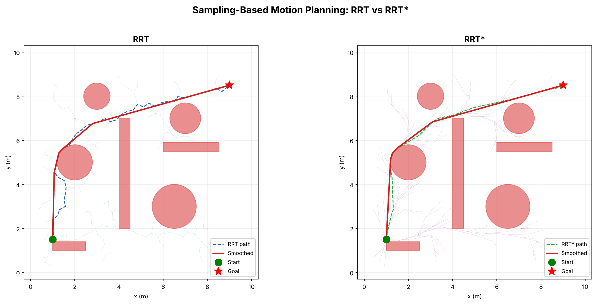
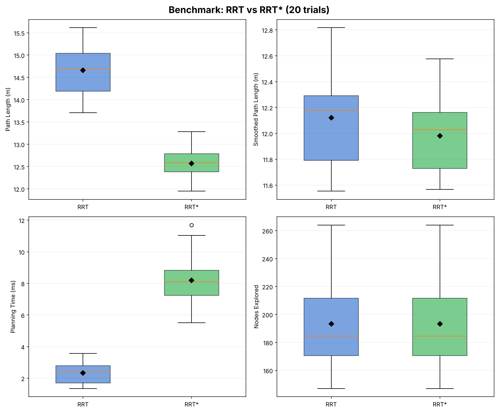

# Motion Planner — 2D Sampling-Based Motion Planning in C++17

A clean, well-documented C++17 library implementing **RRT** and **RRT\*** algorithms for 2D motion planning with obstacles. Includes collision checking, path smoothing, benchmarking, unit tests (GoogleTest), and Python visualization.



## Features

- **RRT (Rapidly-exploring Random Tree)** — probabilistically complete planner with Voronoi bias for fast exploration
- **RRT\* (Optimal RRT)** — asymptotically optimal variant with choose-parent and rewire operations
- **Path Smoothing** — random shortcutting to remove unnecessary detours
- **Collision Checking** — point and segment queries against circular and rectangular obstacles
- **Benchmarking** — multi-trial comparison with CSV export and statistics
- **Visualization** — Python scripts generating publication-quality plots

## Project Structure

```
motion-planner/
├── CMakeLists.txt              # Build system
├── README.md
├── include/motion_planner/
│   ├── types.h                 # Point2D, Circle, Rectangle, Path, PlannerResult
│   ├── environment.h           # Workspace with obstacles, collision checking
│   ├── rrt.h                   # RRT planner
│   ├── rrt_star.h              # RRT* planner (extends RRT)
│   ├── path_smoother.h         # Random shortcutting smoother
│   └── benchmark.h             # Multi-trial benchmarking utilities
├── src/
│   ├── environment.cpp         # Collision checking implementation
│   ├── rrt.cpp                 # RRT algorithm
│   ├── rrt_star.cpp            # RRT* with choose-parent and rewire
│   ├── path_smoother.cpp       # Path optimization
│   ├── benchmark.cpp           # Statistics and CSV export
│   └── main.cpp                # Demo program
├── tests/
│   ├── test_types.cpp          # 12 tests for Point2D, Path, Rectangle
│   ├── test_environment.cpp    # 14 tests for collision and sampling
│   ├── test_rrt.cpp            # 9 tests for RRT correctness
│   ├── test_rrt_star.cpp       # 7 tests for RRT* optimality
│   └── test_path_smoother.cpp  # 7 tests for smoothing
├── scripts/
│   └── visualize.py            # Matplotlib visualization
├── results/                    # Generated CSV data and plots
```

## Requirements

- **C++17** compiler (GCC 9+, Clang 10+)
- **CMake** 3.16+
- **GoogleTest** (for unit tests)
- **Python 3.8+** with `matplotlib` and `numpy` (for visualization)

### Install Dependencies (Ubuntu/Debian)

```bash
sudo apt-get install build-essential cmake libgtest-dev python3 python3-matplotlib
```

## Build & Run

```bash
# Configure and build
mkdir build && cd build
cmake ..
make -j$(nproc)

# Run the demo (generates CSV data in build/results/)
mkdir -p results
./motion_planner

# Run unit tests
ctest --output-on-failure
```

## Visualization

```bash
# From the project root
python3 scripts/visualize.py build/results/

# Output:
#   results/planning_comparison.png  — RRT vs RRT* side-by-side
#   results/benchmark_results.png   — Box plots of 20-trial benchmark
```

## Benchmark Results

Over 20 trials on a 10×10 workspace with 7 obstacles:

| Metric           | RRT (mean) | RRT* (mean) | Improvement |
|------------------|------------|-------------|-------------|
| Path Length      | 14.66 m    | 12.57 m     | **14.3%**   |
| Smoothed Length  | 12.12 m    | 11.98 m     | **1.2%**    |
| Planning Time    | 2.11 ms    | 5.63 ms     | (2.7× slower) |
| Success Rate     | 100%       | 100%        | —           |

**Key takeaway:** RRT\* finds significantly shorter paths than basic RRT (14% improvement before smoothing). After smoothing, the gap narrows but RRT\* still wins. The cost is ~2.7× more planning time due to the neighbor search and rewiring operations.



## How It Works

### RRT Algorithm

1. Initialize tree with the start position
2. Sample a random point in the workspace (with goal bias)
3. Find the nearest node in the tree
4. Extend toward the sample by a fixed step size
5. If the edge is collision-free, add the new node
6. Repeat until a node reaches the goal

### RRT\* Improvements

- **Choose Parent:** Instead of connecting to the nearest node, check all nodes within a radius and pick the one that gives the lowest total cost from start.
- **Rewire:** After adding a new node, check if nearby nodes would be cheaper going through the new node. If so, change their parent.
- These operations make RRT\* **asymptotically optimal** — the path converges to the optimal solution as samples increase.

### Path Smoothing

Random shortcutting: repeatedly pick two random waypoints on the path and try to connect them directly. If the shortcut is collision-free, remove all intermediate waypoints. Simple but effective (used in MoveIt!, OMPL).

## C++ Features Demonstrated

- **C++17:** `std::variant`, `std::visit`, `std::optional`, `std::clamp`, structured bindings
- **OOP:** Inheritance (`RRTStar` extends `RRT`), virtual methods for the Strategy pattern
- **STL:** `vector`, `mt19937`, `uniform_real_distribution`, `chrono`
- **Modern practices:** Smart headers, `const` correctness, namespace scoping
- **Build system:** CMake with separate library target, test discovery
- **Testing:** GoogleTest with parameterized assertions

## Configuration

The `RRTConfig` struct controls planner behavior:

```cpp
RRTConfig cfg;
cfg.step_size   = 0.3;    // max extension per iteration (meters)
cfg.goal_radius = 0.3;    // how close to goal counts as "reached"
cfg.goal_bias   = 0.05;   // probability of sampling the goal directly
cfg.max_iter    = 5000;   // iteration budget
cfg.seed        = 42;     // RNG seed for reproducibility
```

## License

MIT

## Author

Mazen Ben Abid — Engineering Student.
